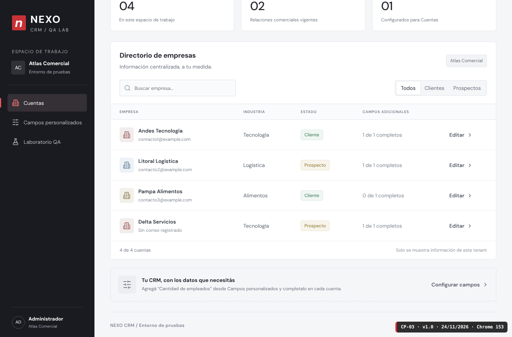
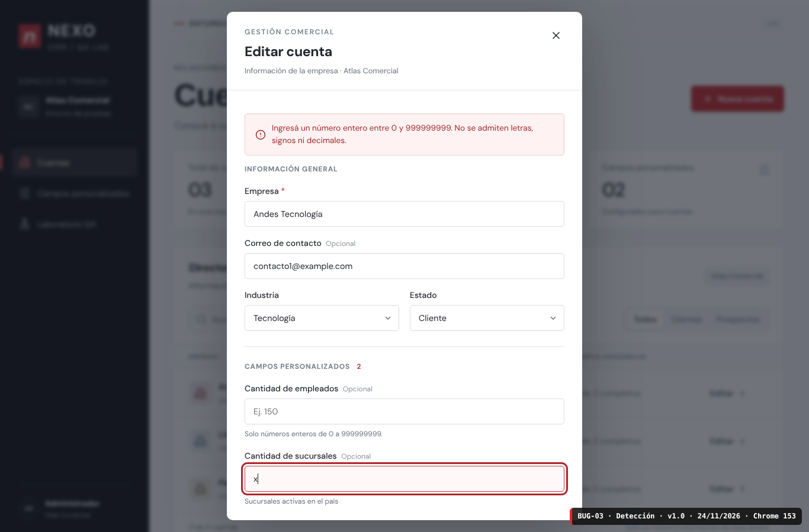
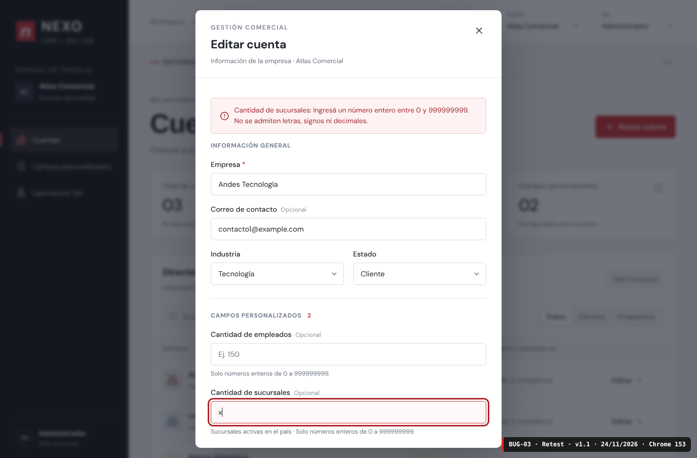

# Portfolio QA · Campo personalizado en un CRM B2B

**Karen Conway** · QA Funcional Manual · karenconway0187@gmail.com

Proyecto de portfolio basado en una **historia de usuario real de CRM B2B**, ejecutado sobre un entorno de pruebas que replica el módulo de Cuentas. Muestra el proceso completo de QA manual: análisis de la historia, diseño y ejecución de casos de prueba, evidencias, reporte de bugs, regresión con Selenium IDE y validación de datos con SQL.

## Resumen

| Casos de prueba | Ejecuciones | Bugs reportados | Regresión |
|:-:|:-:|:-:|:-:|
| 6 (uno por criterio) | v1.0 y v1.1 con evidencias | 4 (3 cerrados, 1 abierto) | 6 tests en Selenium IDE |

## Historia de usuario

> **Como** administrador comercial, **quiero** agregar un campo personalizado llamado "Cantidad de empleados" al formulario de Cuentas, **para** registrar el tamaño de cada cliente sin pedir cambios al sistema.

## Contenido

| # | Documento | Qué muestra |
|---|---|---|
| 01 | [Análisis de la historia de usuario](docs/01-analisis-historia-de-usuario.md) | Criterios de aceptación, preguntas al PO y riesgos. |
| 02 | [Casos de prueba](docs/02-casos-de-prueba.md) · [Excel](docs/casos-de-prueba-HU001.xlsx) | 6 casos con precondición, datos, pasos y resultado esperado. |
| 03 | [Ejecución y evidencias](docs/03-ejecucion-y-evidencias.md) | Resultados en v1.0 y en v1.1, con capturas de cada caso. |
| 04 | [Reporte de bugs](docs/04-reporte-de-bugs.md) | 4 bugs con pasos, severidad, prioridad y retest. |
| 05 | [Validación con SQL](docs/05-validacion-sql.md) | Consultas SELECT y JOIN para verificar los datos guardados. |
| — | [Selenium IDE](selenium-ide/) | Los 6 casos grabados como regresión. |

## Técnicas y herramientas

- **Diseño de pruebas:** partición de equivalencia y valores límite.
- **Tipos de prueba:** funcional, negativa, exploratoria, retest y regresión.
- **Herramientas:** Excel (gestión de casos), Selenium IDE y SQL.

## Ejemplo: un bug de punta a punta

**[BUG-03](docs/04-reporte-de-bugs.md#bug-03) · Severidad Media.** Al tener dos campos personalizados, el mensaje de error no decía cuál de los dos estaba mal. Lo encontré en una prueba exploratoria, lo reporté con pasos y evidencia, y después de la corrección (v1.1) hice el retest.

| Detectado (v1.0) | Retest (v1.1) ✅ |
|:-:|:-:|
|  |  |
