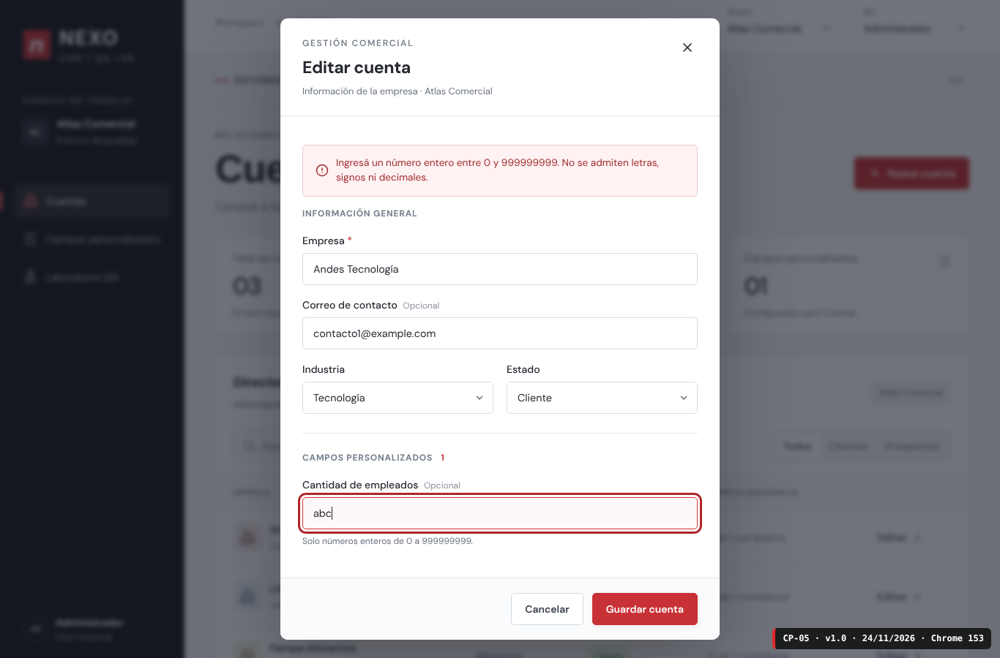

# 03 · Ejecución y evidencias

**Ejecutado por:** Karen Conway · **Navegador:** Chrome 153 · **Fecha:** 24/11/2026

Cada captura tiene una etiqueta abajo a la derecha con el caso, la versión, la fecha y el navegador.

## Resumen

| Ronda | Versión | Ejecutados | PASS | FAIL |
|---|---|---|---|---|
| Ejecución | v1.0 | 6 | 5 | 1 |
| Retest y regresión | v1.1 (con correcciones) | 6 | 6 | 0 |

En la versión 1.0 falló CP-01 (bug [BUG-04](04-reporte-de-bugs.md#bug-04)). Después de la corrección se volvieron a ejecutar los 6 casos (retest del caso que falló y regresión de los demás): todos pasaron.

## Ejecución · v1.0

| ID | Caso | Estado | Resultado obtenido | Evidencia | Bug |
|---|---|---|---|---|---|
| CP-01 | Crear el campo numérico "Cantidad de empleados" | ❌ FAIL | Vacío: "Ingresá el nombre del campo." · 61 caracteres: "El nombre admite hasta 60 caracteres." · Válido: "Campo creado. Ya está disponible en alta y edición de Cuentas." · Duplicado: "Ya existe un campo con ese nombre en este tenant." · Campos en el listado: 1 · Contador: "1 campos" (esperado "1 campo"). | [CP-01-a](evidencias/ejecucion-v1.0/CP-01-a.png) · [CP-01-b](evidencias/ejecucion-v1.0/CP-01-b.png) · [CP-01-c](evidencias/ejecucion-v1.0/CP-01-c.png) | [BUG-04](04-reporte-de-bugs.md#bug-04) |
| CP-02 | El campo aparece en el alta y en la edición de Cuentas | ✅ PASS | Alta: campo visible, opcional y vacío · Edición de "Litoral Logística": campo visible y vacío, datos de la cuenta sin cambios. | [CP-02-a](evidencias/ejecucion-v1.0/CP-02-a.png) · [CP-02-b](evidencias/ejecucion-v1.0/CP-02-b.png) |  |
| CP-03 | Guardar un valor, incluidos los límites 0 y 999999999 | ✅ PASS | Delta Servicios (250), Litoral Logística (0) y Andes Tecnología (999999999): "Cuenta guardada correctamente." y "1 de 1 completos" en las tres. | [CP-03](evidencias/ejecucion-v1.0/CP-03.png) |  |
| CP-04 | El valor se mantiene al reabrir la cuenta y al recargar la página | ✅ PASS | Al reabrir: 80 · Después de recargar (F5): 80. | [CP-04-a](evidencias/ejecucion-v1.0/CP-04-a.png) · [CP-04-b](evidencias/ejecucion-v1.0/CP-04-b.png) |  |
| CP-05 | No se pueden guardar letras ni valores inválidos | ✅ PASS | "abc": rechazado · "12a": rechazado · "-1": rechazado · "1.5": rechazado · "1000000000": rechazado. Al reabrir: 80. | [CP-05-a](evidencias/ejecucion-v1.0/CP-05-a.png) · [CP-05-b](evidencias/ejecucion-v1.0/CP-05-b.png) |  |
| CP-06 | El campo y su valor solo aparecen en el tenant que lo creó | ✅ PASS | Sur Distribuciones: 0 campos, formulario sin "Cantidad de empleados" · Atlas Comercial: Andes Tecnología = 80. | [CP-06-a](evidencias/ejecucion-v1.0/CP-06-a.png) · [CP-06-b](evidencias/ejecucion-v1.0/CP-06-b.png) · [CP-06-c](evidencias/ejecucion-v1.0/CP-06-c.png) |  |

## Retest y regresión · v1.1

| ID | Caso | Estado | Evidencia |
|---|---|---|---|
| CP-01 | Crear el campo numérico "Cantidad de empleados" | ✅ PASS | [CP-01-a](evidencias/retest-v1.1/CP-01-a.png) · [CP-01-b](evidencias/retest-v1.1/CP-01-b.png) · [CP-01-c](evidencias/retest-v1.1/CP-01-c.png) |
| CP-02 | El campo aparece en el alta y en la edición de Cuentas | ✅ PASS | [CP-02-a](evidencias/retest-v1.1/CP-02-a.png) · [CP-02-b](evidencias/retest-v1.1/CP-02-b.png) |
| CP-03 | Guardar un valor, incluidos los límites 0 y 999999999 | ✅ PASS | [CP-03](evidencias/retest-v1.1/CP-03.png) |
| CP-04 | El valor se mantiene al reabrir la cuenta y al recargar la página | ✅ PASS | [CP-04-a](evidencias/retest-v1.1/CP-04-a.png) · [CP-04-b](evidencias/retest-v1.1/CP-04-b.png) |
| CP-05 | No se pueden guardar letras ni valores inválidos | ✅ PASS | [CP-05-a](evidencias/retest-v1.1/CP-05-a.png) · [CP-05-b](evidencias/retest-v1.1/CP-05-b.png) |
| CP-06 | El campo y su valor solo aparecen en el tenant que lo creó | ✅ PASS | [CP-06-a](evidencias/retest-v1.1/CP-06-a.png) · [CP-06-b](evidencias/retest-v1.1/CP-06-b.png) · [CP-06-c](evidencias/retest-v1.1/CP-06-c.png) |

## Algunas evidencias

**CP-05 · El sistema rechaza "abc"**

**CP-06 · En otro tenant el campo no existe**

**CP-01 · Falla en v1.0: el contador dice "1 campos"**

