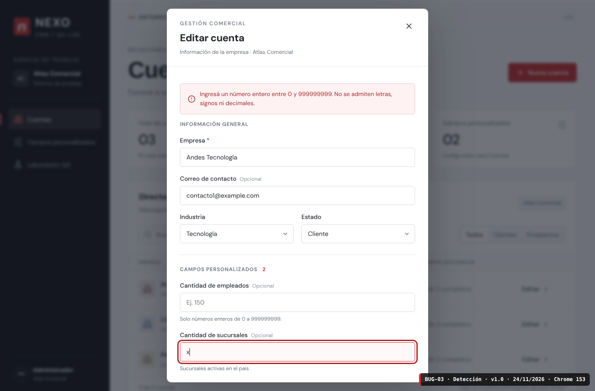
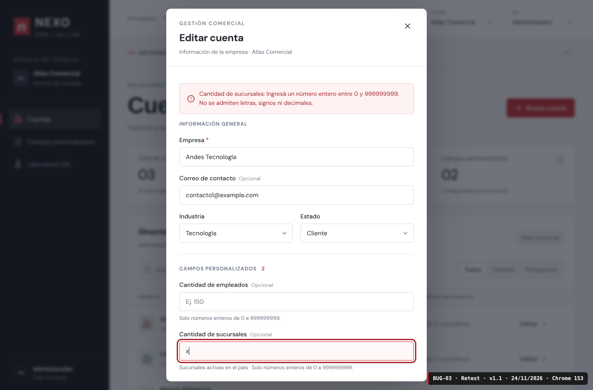

# 04 · Reporte de bugs

**Reportados por:** Karen Conway · **Navegador:** Chrome 153 · **Versión probada:** v1.0

Un bug salió de los casos de prueba (BUG-04). Los otros tres aparecieron en una **prueba exploratoria** de 30 minutos, en la que probé cosas que los casos no cubren: nombres muy largos, dos campos personalizados a la vez y textos de la pantalla.

| ID | Título | Severidad | Prioridad | Estado |
|---|---|---|---|---|
| [BUG-01](#bug-01) | El aviso "Agregá Cantidad de empleados" sigue visible después de crear el campo | Baja | Media | ✅ Cerrado en v1.1 |
| [BUG-02](#bug-02) | Un nombre de campo largo sin espacios se superpone con la etiqueta "Activo" | Baja | Baja | ⏸ Abierto (para el próximo sprint) |
| [BUG-03](#bug-03) | Con dos campos personalizados, el error no dice cuál campo está mal | Media | Media | ✅ Cerrado en v1.1 |
| [BUG-04](#bug-04) | El contador de campos dice "1 campos" | Baja | Baja | ✅ Cerrado en v1.1 |

**Severidad** = cuánto afecta al sistema. **Prioridad** = qué tan urgente es corregirlo para el negocio.

---

## BUG-01 · El aviso "Agregá Cantidad de empleados" sigue visible después de crear el campo

- **Severidad:** Baja · **Prioridad:** Media (invita a crear un campo que ya existe)
- **Entorno:** v1.0 · Chrome 153 · tenant Atlas Comercial · rol Administrador
- **Reproducible:** 3 de 3 veces

**Pasos**

1. Ir a Campos personalizados y crear el campo "Cantidad de empleados".
2. Ir a Cuentas y bajar hasta el final de la página.

**Resultado esperado:** si el campo ya existe, no debería aparecer el aviso que invita a crearlo.

**Resultado obtenido:** el aviso sigue visible, aunque arriba dice que hay 1 campo personalizado.

| Detectado (v1.0) | Retest (v1.1) ✅ |
|:-:|:-:|
|  |  |

---

## BUG-02 · Un nombre de campo largo sin espacios se superpone con la etiqueta "Activo"

- **Severidad:** Baja · **Prioridad:** Baja (es poco probable un nombre así)
- **Entorno:** v1.0 · Chrome 153 · 1366×900
- **Reproducible:** 3 de 3 veces

**Pasos**

1. Crear un campo con un nombre de 60 letras seguidas, sin espacios (el máximo permitido).
2. Mirar el campo en el listado de Campos personalizados.

**Resultado esperado:** el nombre se ve completo o cortado con "…", sin taparse con otros elementos.

**Resultado obtenido:** el nombre queda cortado y se superpone con la etiqueta "Activo".

**Estado:** abierto. Por su baja severidad se propone corregirlo en el próximo sprint.

---

## BUG-03 · Con dos campos personalizados, el error no dice cuál campo está mal

- **Severidad:** Media · **Prioridad:** Media (el módulo está pensado para tener varios campos)
- **Entorno:** v1.0 · Chrome 153 · tenant Atlas Comercial
- **Reproducible:** 3 de 3 veces

**Pasos**

1. Crear "Cantidad de empleados" y un segundo campo "Cantidad de sucursales" con la descripción "Sucursales activas en el país".
2. Editar Andes Tecnología, escribir "x" en Cantidad de sucursales y guardar.

**Resultado esperado:** el mensaje indica qué campo tiene el error, y los dos campos muestran la ayuda de formato.

**Resultado obtenido:** el mensaje es genérico y no nombra el campo. Además, en el campo con descripción desaparece la ayuda "Solo números enteros de 0 a 999999999".

| Detectado (v1.0) | Retest (v1.1) ✅ |
|:-:|:-:|
|  |  |

---

## BUG-04 · El contador de campos dice "1 campos"

- **Severidad:** Baja · **Prioridad:** Baja
- **Entorno:** v1.0 · Chrome 153
- **Detectado en:** [CP-01](02-casos-de-prueba.md#cp-01)

**Pasos**

1. Crear un solo campo personalizado.
2. Mirar la etiqueta arriba a la derecha del panel "Campos de Cuentas".

**Resultado esperado:** "1 campo".

**Resultado obtenido:** "1 campos".

| Detectado (v1.0) | Retest (v1.1) ✅ |
|:-:|:-:|
|  |  |
